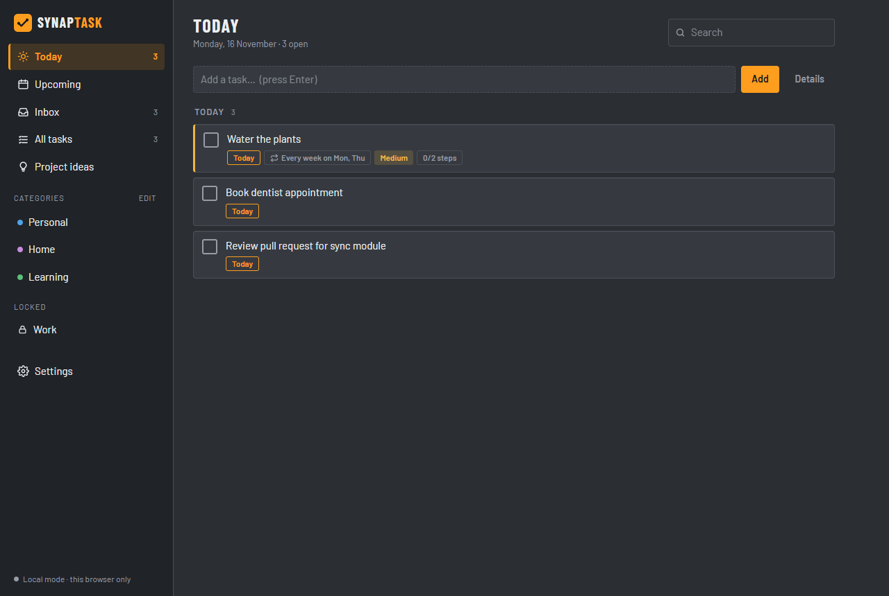
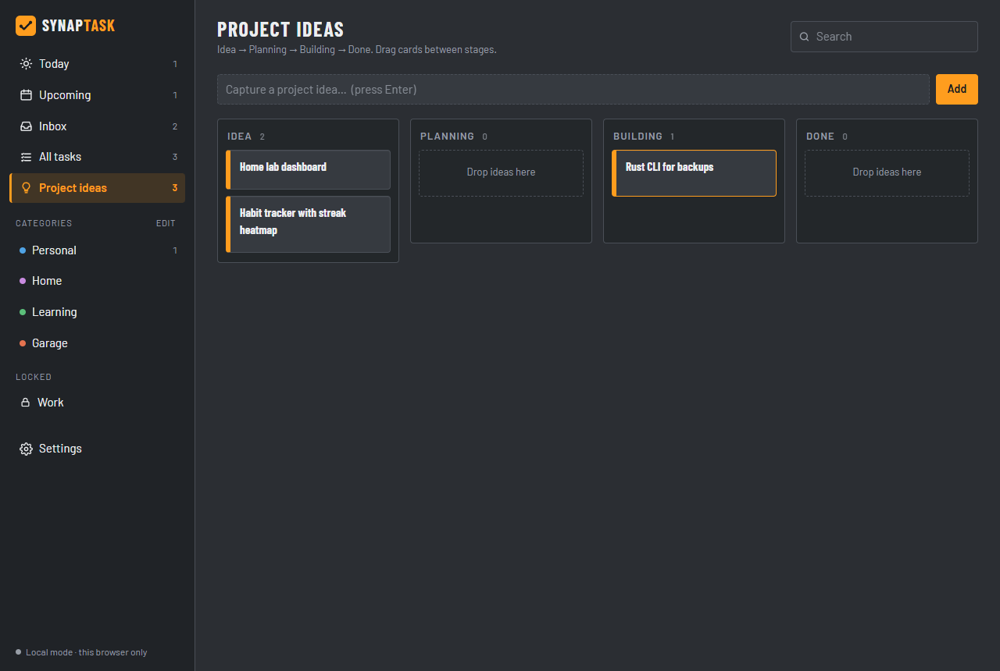
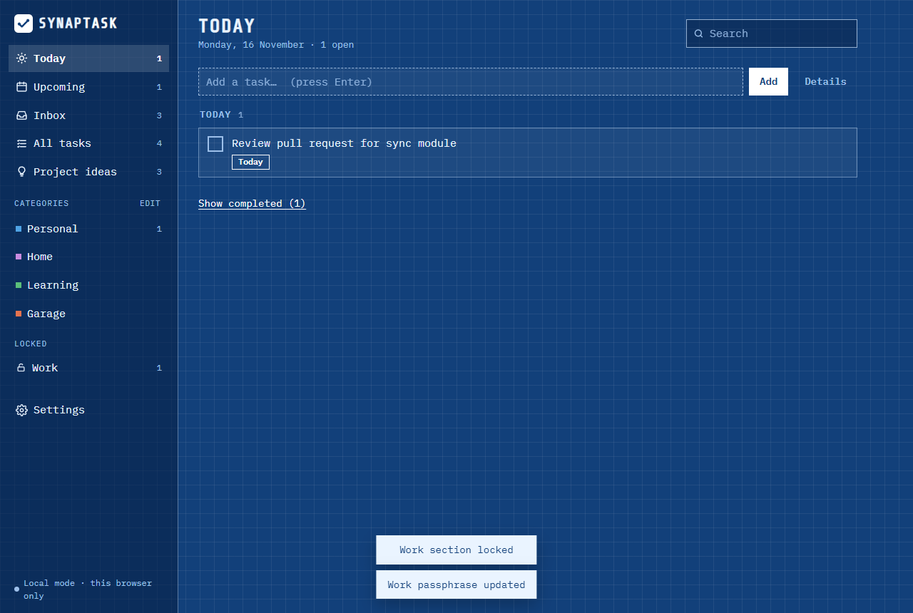
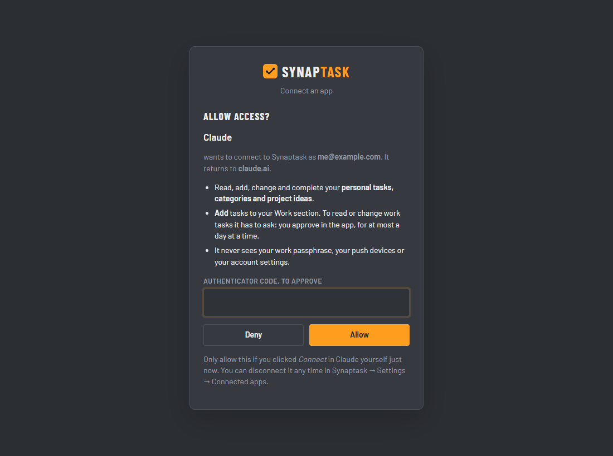

<a id="readme-top"></a>

<div align="center">
  

  <h1>Synaptask</h1>

  <p>
    <em>Clean your mind.</em><br>
    A personal to-do and project-ideas app that syncs across your devices,
    reminds you by push and email, and lets Claude manage your tasks from any chat.
  </p>

  <p>
    <a href="https://github.com/denis-furtuna/synaptask/actions/workflows/pages.yml"></a>
    
    
    
  </p>

  <p>
    <a href="#getting-started"><strong>Get started »</strong></a>
    ·
    <a href="#usage">Usage</a>
    ·
    <a href="#security">Security</a>
    ·
    <a href="https://github.com/denis-furtuna/synaptask/issues">Report a bug</a>
  </p>
</div>

<details>
  <summary>Table of contents</summary>
  <ol>
    <li><a href="#about-the-project">About the project</a>
      <ul>
        <li><a href="#features">Features</a></li>
        <li><a href="#built-with">Built with</a></li>
        <li><a href="#architecture">Architecture</a></li>
      </ul>
    </li>
    <li><a href="#getting-started">Getting started</a>
      <ul>
        <li><a href="#try-it-locally">Try it locally</a></li>
        <li><a href="#prerequisites">Prerequisites</a></li>
        <li><a href="#installation">Installation</a></li>
      </ul>
    </li>
    <li><a href="#usage">Usage</a></li>
    <li><a href="#security">Security</a></li>
    <li><a href="#troubleshooting">Troubleshooting</a></li>
    <li><a href="#development">Development</a></li>
    <li><a href="#roadmap">Roadmap</a></li>
    <li><a href="#contributing">Contributing</a></li>
    <li><a href="#license">License</a></li>
    <li><a href="#contact">Contact</a></li>
    <li><a href="#acknowledgments">Acknowledgments</a></li>
  </ol>
</details>

## About the project



Synaptask is a single-user task manager built as an installable web app (PWA). It runs on Windows,
macOS, Linux, Android and iPhone from one codebase, keeps working offline, and syncs through your own
Supabase project. A built-in connector lets Claude add, list, change and complete tasks from claude.ai,
the Claude desktop and mobile apps, and Claude Code.

Work tasks live in a separate, locked section that is end-to-end encrypted on your device.

### Features

- **Tasks by category** with due dates and times, priorities, steps (subtasks) and daily, weekly,
  monthly or yearly repeats.
- **Project ideas board** with the stages Idea → Planning → Building → Done. Each idea has notes,
  tags, links and its own task list.
- **Shopping list** with your own categories (Groceries, For projects, Fun… editable); tick items off as you
  buy them, link an item to a project idea.
- **Autosave**: tasks, ideas and shopping items save while you type and whenever the editor closes.
- **Locked Work section**, encrypted with its own passphrase. Claude can always *add* work tasks; to
  read or change them it has to ask, and you approve in the app for a limited time (1 hour up to a day).
- **Claude connector** over MCP and OAuth, limited to Claude and approved with an authenticator code.
- **Reminders** by push notification and email.
- **Sign-in with two factors**: email, password and an authenticator-app code.
- **Offline first**: every change is saved locally and synced when you are back online.
- **12 themes**, backup export and import, keyboard shortcuts.

<table>
  <tr>
    <td width="50%"></td>
    <td width="50%"></td>
  </tr>
  <tr>
    <td align="center"><sub>Project ideas board</sub></td>
    <td align="center"><sub>One of the 12 themes (Blueprint)</sub></td>
  </tr>
</table>

### Built with

[![JavaScript][js-badge]][js-url]
[![Supabase][supabase-badge]][supabase-url]
[![PostgreSQL][postgres-badge]][postgres-url]
[![Deno][deno-badge]][deno-url]
[![GitHub Pages][pages-badge]][pages-url]
[![Model Context Protocol][mcp-badge]][mcp-url]

### Architecture

| Part | Where | Notes |
|---|---|---|
| Web app (PWA) | `web/` | Plain JavaScript modules, no build step, no framework. Hosted on GitHub Pages. |
| Database and sign-in | Supabase | Postgres with Row Level Security; email, password and authenticator code (TOTP). |
| Claude connector | `supabase/functions/mcp` | Edge Function; Supabase Auth is the OAuth 2.1 server. |
| Reminders | `supabase/functions/reminders` | Edge Function run every minute by `pg_cron`; Web Push and email (Resend). |
| Schema | `supabase/migrations/` | Tables, limits and security policies. |
| Tools | `tools/` | Server key generator and a browser self-test. |

<p align="right">(<a href="#readme-top">back to top</a>)</p>

## Getting started

### Try it locally

No accounts needed. Without a server configured the app runs in **local mode** and keeps everything
in that browser. To see local mode, empty `supabaseUrl` and `supabaseKey` in `web/js/config.js` first.

```sh
python -m http.server 8000      # in the repository folder
```

- App: <http://localhost:8000/web/>
- Self-test (recurrence, Work-vault crypto, local store): <http://localhost:8000/tools/selftest.html>

### Prerequisites

- A [GitHub](https://github.com) account (hosting on GitHub Pages)
- A free [Supabase](https://supabase.com) project (database, sign-in, functions)
- A free [Resend](https://resend.com) account (reminder emails)
- The [Supabase CLI](https://supabase.com/docs/guides/cli) and, for the tests, [Deno](https://deno.com)
- An authenticator app on your phone

Below, `<you>` is your GitHub user name and `<ref>` is your Supabase project ref (the part before
`.supabase.co`).

### Installation

<details open>
<summary><strong>1. GitHub Pages</strong></summary>

1. Fork or copy this repository and make it public (GitHub Pages on a private repository needs a paid plan;
   the repository holds no secrets).
2. Repository → **Settings → Pages → Build and deployment → Source: GitHub Actions**.
3. Every push to `main` runs the tests and deploys `web/` to `https://<you>.github.io/synaptask/`.

</details>

<details>
<summary><strong>2. Supabase project</strong></summary>

1. Create a project: region close to you, *Enable Data API* **on**, *Automatically expose new tables* **off**,
   *Enable automatic RLS* **on**, Postgres type **Postgres** (default). Keep the database password in a
   password manager, or in `.secrets/` in this folder, which git ignores.
2. **Project Settings → JWT Keys**: the current key must be asymmetric (ECC P-256 or RSA). New projects are.
3. **Authentication → Sign In / Providers → Email**: enabled, *Confirm email* on, *Minimum password length* 12,
   *Require current password when updating* off, magic links off.
4. **Authentication → Multi-Factor**: TOTP (authenticator app) enabled.
5. **Authentication → URL Configuration**:
   - Site URL: `https://<you>.github.io/synaptask`
   - Redirect URLs: `https://<you>.github.io/synaptask/**` and `http://localhost:8000/**`
6. **Authentication → OAuth Server**: enable it, *Authorization path* `/consent.html`, turn on
   *Allow Dynamic OAuth Apps* (Claude registers itself; see [Security](#security) for how other apps are kept out).
7. **Project Settings → API Keys**: note the **publishable** key (`sb_publishable_…`) and the **secret** key
   named `default` (`sb_secret_…`). The secret key never goes in the repository.

Then, in a terminal in the repository folder:

```sh
supabase login
supabase link --project-ref <ref>
supabase db push --remote                          # tables and security rules
supabase functions deploy mcp --no-verify-jwt --use-api
supabase functions deploy reminders --no-verify-jwt --use-api
supabase db advisors --remote --type security      # optional: Supabase's own security check
```

CLI 3.x targets a local database unless you pass `--remote`; `--use-api` bundles the functions on
Supabase's side, so Docker is not needed. The advisor lists three intended warnings (the helper functions
`oauth_client_trusted`, `vault_public_key` and `work_grant_active`).

Do **not** run `supabase config push`: `supabase/config.toml` only holds function settings, and pushing it
would reset the Auth settings above.

</details>

<details>
<summary><strong>3. Server keys</strong></summary>

1. With the local server running, open <http://localhost:8000/tools/keys.html> and click *Generate both key pairs*.
2. Copy the two **public key** lines into `web/js/config.js` (`vapidPublicKey`, `grantPublicKey`).
3. Keep the tab open for the two private keys (step 5).

</details>

<details>
<summary><strong>4. Email (Resend)</strong></summary>

1. Create a Resend account **with the same email address you will use for Synaptask**. Without your own
   domain, Resend only delivers to your own address, which is all a personal app needs.
2. **API Keys → Create** (permission *Sending access*) and copy the key (`re_…`).

</details>

<details>
<summary><strong>5. Function secrets</strong></summary>

Create the file `supabase/.env` (git ignores it):

```ini
VAPID_PRIVATE_JWK='{"kty":"EC",...}'        # the two lines from tools/keys.html
GRANT_PRIVATE_JWK='{"kty":"RSA",...}'
VAPID_CONTACT=mailto:you@example.com
RESEND_API_KEY=re_...
APP_URL=https://<you>.github.io/synaptask/
# REMINDER_FROM=Synaptask <reminders@your-domain>   (only with your own domain in Resend)
```

```sh
supabase secrets set --env-file supabase/.env
rm supabase/.env
```

</details>

<details>
<summary><strong>6. Schedule the reminders</strong></summary>

Open **SQL Editor** in Supabase, paste `supabase/sql/schedule_reminders.sql`, replace `YOUR-PROJECT-REF` and
`YOUR-SECRET-KEY`, run it, and do not save the query with the key in it. The editor prints the job number
(`1`) when it worked.

</details>

<details>
<summary><strong>7. Point the app at the server</strong></summary>

Fill in `web/js/config.js`. All values are public by design: the publishable key only works together with
the database's security rules, and the private halves of the two keys are secrets.

```js
export const CONFIG = {
  supabaseUrl: 'https://<ref>.supabase.co',
  supabaseKey: 'sb_publishable_...',
  vapidPublicKey: '...',
  grantPublicKey: { kty: 'RSA', n: '...', e: 'AQAB' },
};
```

Commit and push. When the GitHub Action is green, open `https://<you>.github.io/synaptask/`:

1. **Create account**, open the confirmation email, sign in.
2. **Scan the QR code** with an authenticator app. Also save the text key in your password manager: it is
   the only way to move the code to a new phone.
3. In Supabase, turn **Allow new users to sign up** off. It is a one-person app.
4. Open **Work**, choose a work passphrase (different from your password) and store the **recovery key**
   somewhere safe outside the app.
5. **Settings → Reminders → Turn on** on each device. On iPhone, first *Share → Add to Home Screen* and open
   Synaptask from the icon; iOS only allows push for installed web apps.
6. Install the app: Chrome and Edge show *Install app*; on Android use *Add to Home screen*.

</details>

<details>
<summary><strong>8. Connect Claude</strong></summary>

- **claude.ai, Claude Desktop, Claude mobile**: Settings → Connectors → *Add custom connector* → name
  `Synaptask`, URL `https://<ref>.supabase.co/functions/v1/mcp`, keep the detected options → *Connect*.
  Sign in to Synaptask, type your authenticator code and approve.
- **Claude Code**: connectors added on claude.ai appear in new Claude Code sessions. To add it directly:
  ```sh
  claude mcp add --transport http synaptask https://<ref>.supabase.co/functions/v1/mcp
  ```
  then run `/mcp` and choose Synaptask to sign in.

</details>

<p align="right">(<a href="#readme-top">back to top</a>)</p>

## Usage

Ask Claude in any chat:

- *"Add 'renew passport' to Synaptask for next Friday, high priority."*
- *"What's due today?"*
- *"Add milk, eggs and 2 rolls of PLA (for projects) to my shopping list."*
- *"Put 'prepare Q4 review' in my work tasks."*
- *"What's on my work list this week?"* This one needs your approval: open Synaptask → **Work**, pick a
  duration, tap **Allow**, then tell Claude to try again.



### What Claude can and cannot do

| | Personal tasks, categories, ideas, shopping list | Work section |
|---|---|---|
| Claude, normally | read, add, change, complete, delete | **add only** (sealed; cannot read, list or change) |
| Claude, while you allow it | same | read, add, change, complete, delete, until the time you chose (max 24 h) |
| Someone with only your password | nothing | nothing |
| Supabase / the server | stores it | ciphertext and reminder times only; during an approved window the server can open the Work key |

*Stop now* in the Work section ends Claude's access at once. Locking the app does **not** end it; the time
limit or *Stop now* does.

### Connector tools

`list_categories`, `list_tasks`, `add_task`, `update_task`, `complete_task`, `delete_task`, `list_ideas`,
`add_idea`, `update_idea`, `list_shopping`, `add_shopping_items`, `update_shopping_item`, `delete_shopping_item`,
`add_work_task`, and with your approval `list_work_categories`, `list_work_tasks`,
`update_work_task`, `complete_work_task`, `delete_work_task`.

### Keyboard

`/` search · `n` new task · `Esc` close a dialog

<p align="right">(<a href="#readme-top">back to top</a>)</p>

## Security

- **Row Level Security on every table.** You only ever see your own rows, and only with a session that
  passed the authenticator code. A stolen password alone reads nothing.
- **Only Claude can be connected.** The project allows dynamic client registration (Claude needs it), so
  anyone could register an app. The consent page refuses every app that does not return to Claude
  (`claude.ai`, `claude.com`, or `localhost` for Claude Code), asks for a fresh authenticator code, and then
  puts the app on your **trusted list**. The database lets a connector token in only if its app is on that
  list, and only the app itself can edit the list.
- **Trust covers one session.** Supabase issues connector tokens at password level, so trust is bound to the
  first session the app opens right after your approval (within 10 minutes). Any other session of the same
  app is refused. If Claude says it is "not on the trusted list", disconnect it in
  *Settings → Connected apps* and connect it again.
- **Work items are end-to-end encrypted.** PBKDF2-SHA256 (600,000 iterations) derives a key that wraps a
  random AES-256-GCM vault key; each item is bound to its id. The connector seals new work tasks to the
  vault's RSA-OAEP-3072 public key and cannot read them back. The vault key lives in memory only and locks
  after 5 idle minutes (configurable).
- **Time-limited Work access.** A grant is the Work key sealed in the app to the server's public key. The
  database caps it at 24 hours, only your app can create, extend or delete it, and expired grants are
  deleted every minute.
- **Hardened front end.** Strict Content-Security-Policy, all user text escaped, links limited to
  http and https, frames refused. Sign-out wipes the local cache.

Found a vulnerability? Please report it privately through
[GitHub security advisories](https://github.com/denis-furtuna/synaptask/security/advisories/new)
rather than a public issue.

<p align="right">(<a href="#readme-top">back to top</a>)</p>

## Troubleshooting

- **Lost the phone with the authenticator**: Supabase dashboard → Authentication → Users → your user →
  remove the MFA factor, then sign in and enrol again.
- **Forgot the work passphrase**: Work → *Forgot the passphrase? Use your recovery key*. Without the
  passphrase and the recovery key, work items cannot be recovered by anyone.
- **Reminders not arriving**: SQL Editor →
  `select * from cron.job_run_details order by start_time desc limit 5;` and Edge Functions → reminders → Logs.
- **Claude sees no tasks**: Settings → Connected apps → Disconnect, then connect again from Claude.
- **The app looks out of date**: an open app checks for a new version when you come back to it and reloads
  itself (or tells you it will, if you are in the middle of editing). To force it: Ctrl+Shift+R, or close and
  reopen the installed app.

<p align="right">(<a href="#readme-top">back to top</a>)</p>

## Development

```sh
deno test -A supabase/        # security rules (on PGlite), connector, reminders, recurrence parity, crypto
deno check supabase/functions/mcp/index.ts supabase/functions/reminders/index.ts
```

GitHub Actions runs both before every deploy. The browser self-test is `tools/selftest.html`.

Rules of the codebase:

- No build step and no dependencies in `web/` besides the vendored supabase-js.
- Secrets only as Edge Function secrets, never in the repository.
- `web/js/recurrence.js` and `supabase/functions/_shared/recurrence.ts` must behave the same
  (a test compares 20,000 random cases).
- When adding a file to `web/`, add it to `SHELL` in `web/sw.js`.

<p align="right">(<a href="#readme-top">back to top</a>)</p>

## Roadmap

- [x] Tasks, categories, recurring tasks, project ideas board
- [x] Encrypted Work section with recovery key
- [x] Claude connector with time-limited Work access
- [x] Push and email reminders
- [ ] Verify push on iPhone (installed to the Home Screen)
- [ ] Google Play release as a Trusted Web Activity

<p align="right">(<a href="#readme-top">back to top</a>)</p>

## Contributing

This is a personal project, but bug reports and suggestions are welcome: open an
[issue](https://github.com/denis-furtuna/synaptask/issues) and describe what you expected and what happened.
Please talk to the author before sending a pull request.

<p align="right">(<a href="#readme-top">back to top</a>)</p>

## License

No open-source license. All rights reserved: you may read the code, but not reuse or redistribute it
without permission.

<p align="right">(<a href="#readme-top">back to top</a>)</p>

## Contact

Denis Furtuna · [@denis-furtuna](https://github.com/denis-furtuna)

Project link: <https://github.com/denis-furtuna/synaptask>

<p align="right">(<a href="#readme-top">back to top</a>)</p>

## Acknowledgments

- [Supabase](https://supabase.com): database, auth, Edge Functions
- [Model Context Protocol](https://modelcontextprotocol.io): the connector standard
- [PGlite](https://pglite.dev): Postgres in WebAssembly, used to test the security rules
- [PushForge](https://github.com/draphy/pushforge): Web Push from Deno
- [Resend](https://resend.com): reminder emails
- [Best-README-Template](https://github.com/othneildrew/Best-README-Template): the structure of this file

<p align="right">(<a href="#readme-top">back to top</a>)</p>

[js-badge]: https://img.shields.io/badge/JavaScript-ES%20modules-f7df1e?logo=javascript&logoColor=black
[js-url]: https://developer.mozilla.org/docs/Web/JavaScript/Guide/Modules
[supabase-badge]: https://img.shields.io/badge/Supabase-3fcf8e?logo=supabase&logoColor=white
[supabase-url]: https://supabase.com
[postgres-badge]: https://img.shields.io/badge/PostgreSQL-4169e1?logo=postgresql&logoColor=white
[postgres-url]: https://www.postgresql.org
[deno-badge]: https://img.shields.io/badge/Deno-000000?logo=deno&logoColor=white
[deno-url]: https://deno.com
[pages-badge]: https://img.shields.io/badge/GitHub%20Pages-222222?logo=githubpages&logoColor=white
[pages-url]: https://pages.github.com
[mcp-badge]: https://img.shields.io/badge/Model%20Context%20Protocol-d97757
[mcp-url]: https://modelcontextprotocol.io
